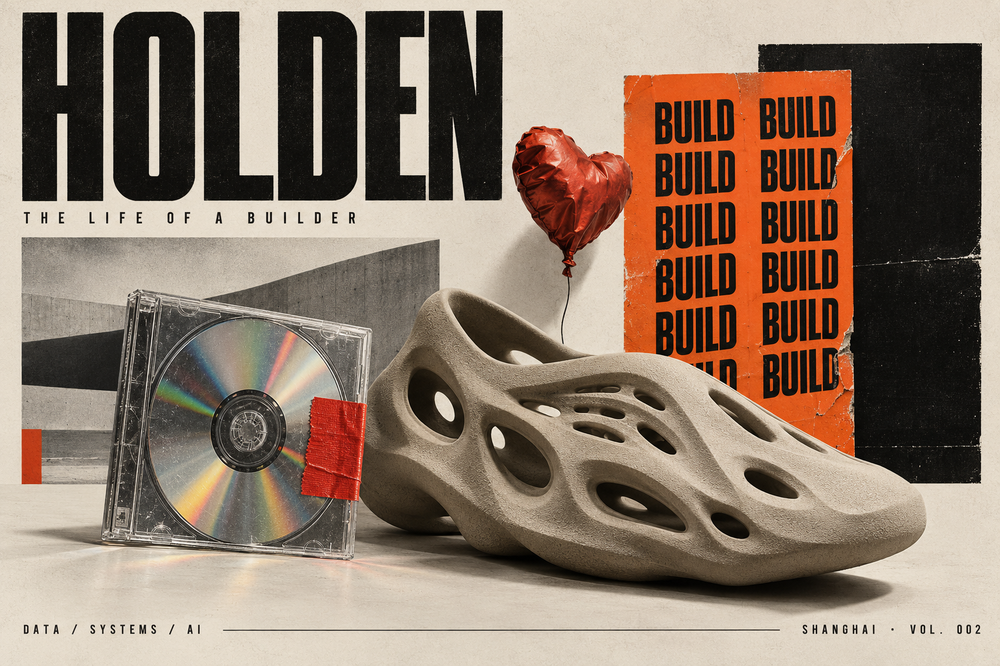
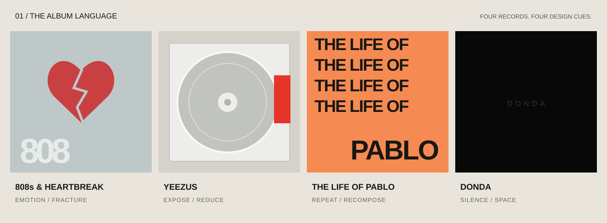
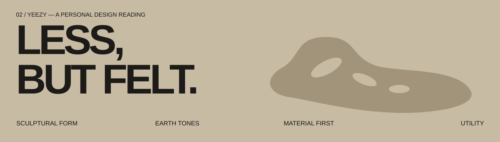

 

**HOLDEN / FLOWER0313** &nbsp; · &nbsp; SHANGHAI

**DATA ENGINEERING × SYSTEMS × AI AGENTS**

*Make it work. Give it a point of view.*

[REPOSITORIES](https://github.com/Flower0313?tab=repositories) &nbsp; / &nbsp; [STARS](https://github.com/Flower0313?tab=stars)

---

### 00 / THE LIFE OF A BUILDER

I'm Holden, a data engineer based in Shanghai. I build data pipelines, work with large-scale systems, and explore AI agents that can do useful work.

在数据、系统与 AI 之间做东西。喜欢 Kanye 专辑视觉里的实验精神，也喜欢 YEEZY 把日常物件做成雕塑的方式：**形式要有态度，系统要能落地。**

`BUILD FIRST` &nbsp; `QUESTION EVERYTHING` &nbsp; `KEEP REFINING`

 

### 01 / RECORDS → METHODS

| RECORD | VISUAL CUE | HOW I BUILD |
| :--- | :--- | :--- |
| **808s & Heartbreak** | 冷灰与破碎的心形 | 技术之外，也照顾使用者的感受。 |
| **Yeezus** | 透明唱片、红色胶带、裸露结构 | 把复杂系统拆开，让关键逻辑清晰可见。 |
| **The Life of Pablo** | 橙色、重复、拼贴 | 持续试验，在迭代中找到自己的表达。 |
| **Donda** | 黑色与留白 | 减少噪声，把注意力留给真正重要的内容。 |

 

### 02 / FROM YEEZY TO SYSTEMS

我对 YEEZY 设计语言的理解，是**雕塑感轮廓、低饱和大地色、材质表达与日常功能**。把这套审美带回工程里：界面少一点负担，模块有清晰边界，工具围绕真实任务组织。

**FORM** — 清楚的结构，让复杂性有容器。  
**MATERIAL** — 理解数据、代码与基础设施本身的特性。  
**UTILITY** — 做出来的东西，应该有人愿意一直用。

### 03 / THE TOOLBOX

| LAYER | MATERIALS |
| :--- | :--- |
| **DATA** | SQL · MaxCompute · Hologres · Kafka · Hadoop · MySQL |
| **CODE** | Python · Java · Git · Bash |
| **SYSTEMS** | Linux · Docker · Redis · Nginx |
| **EXPLORING** | LLMs · MCP · AI Agents · Automation |
| **SIDE QUEST** | IELTS · English · Continuous learning |

---

### IDEAS ARE THE DEMO. BUILDING IS THE WORK.

HOLDEN ARCHIVE / VOL. 002 / ALWAYS IN PROGRESS

  

Original fan-made visual studies inspired by Kanye West’s album artwork and YEEZY design language. Personal interpretations, not artist quotations. Independent personal profile; no affiliation.

