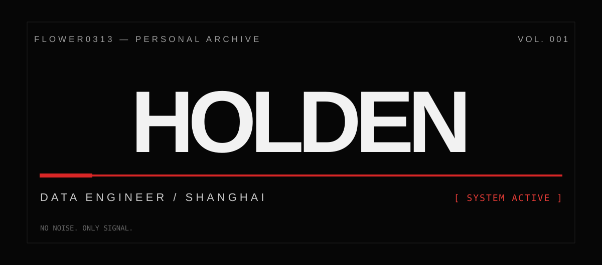
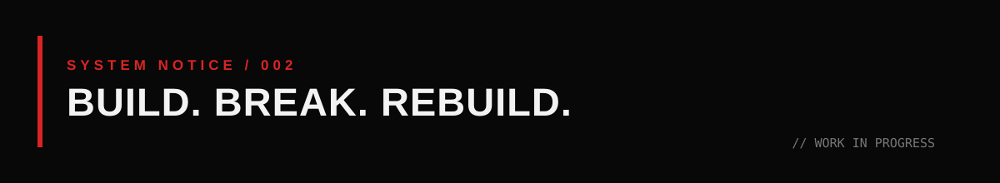

<div align="center">



<br>

<sub><strong>HOLDEN / FLOWER0313</strong> &nbsp;—&nbsp; SHANGHAI, CHINA</sub>

<br><br>

**BIG DATA ENGINEER** &nbsp; / &nbsp; **DATA SYSTEMS** &nbsp; / &nbsp; **AI AGENTS**

<br>

<sup>NO NOISE. ONLY SIGNAL.</sup>

</div>

<br>

---

### 01 — THE PERSON

```text
NAME        HOLDEN
LOCATION    SHANGHAI
DISCIPLINE  DATA ENGINEERING
EXPLORING   AI AGENTS / AUTOMATION / INTELLIGENT SYSTEMS
SIDE QUEST  IELTS
MINDSET     BUILD FIRST. QUESTION EVERYTHING.
```

### 02 — THE WORK

I build data pipelines, work with large-scale data systems, and explore ways to make AI agents useful beyond demos.

**DATA** `SQL` · `MaxCompute` · `Hologres` · `Kafka` · `Hadoop` · `MySQL`  
**CODE** `Python` · `Java` · `Git` · `Bash`  
**SYSTEMS** `Linux` · `Docker` · `Redis` · `Nginx`  
**EXPLORING** `LLMs` · `MCP` · `AI Agents` · `Automation`

<br>

<div align="center">
  
</div>

<br>

### 03 — ACTIVITY

<div align="center">

<a href="https://github.com/Flower0313?tab=repositories">REPOSITORIES</a> &nbsp;&nbsp; / &nbsp;&nbsp; <a href="https://github.com/Flower0313?tab=stars">STARS</a> &nbsp;&nbsp; / &nbsp;&nbsp; <a href="https://github.com/Flower0313">PROFILE</a>

<br><br>

<!-- Optional external stats image intentionally omitted to avoid broken cards and inconsistent themes. -->


</div>

<br>

---

<div align="center">

<sub><strong>THIS IS NOT THE FINAL VERSION.</strong></sub>

<br>

<sup>BUILD / BREAK / REBUILD</sup>

<br><br>

<a href="https://github.com/Flower0313">GITHUB ↗</a>

</div>
